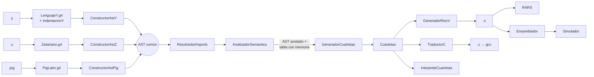
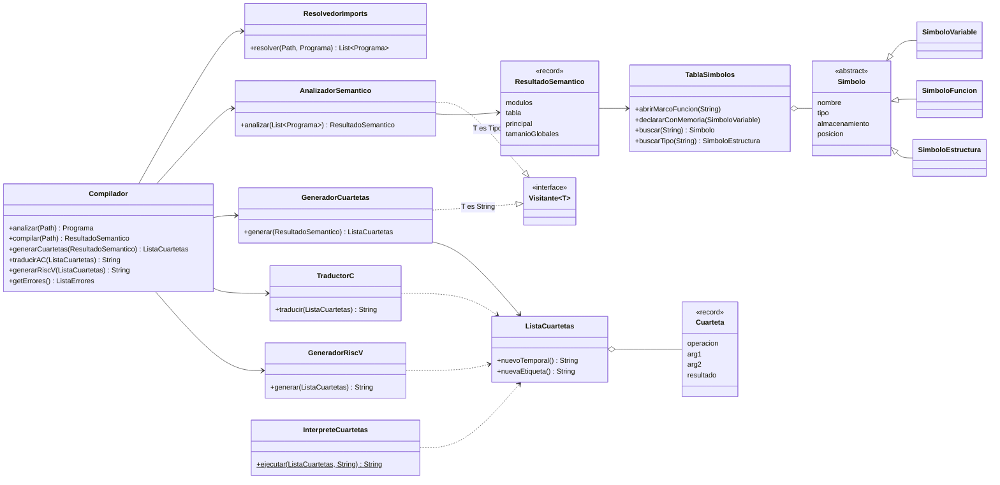
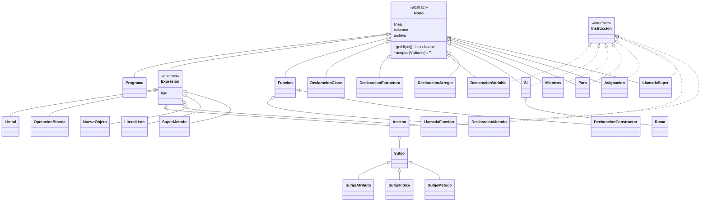
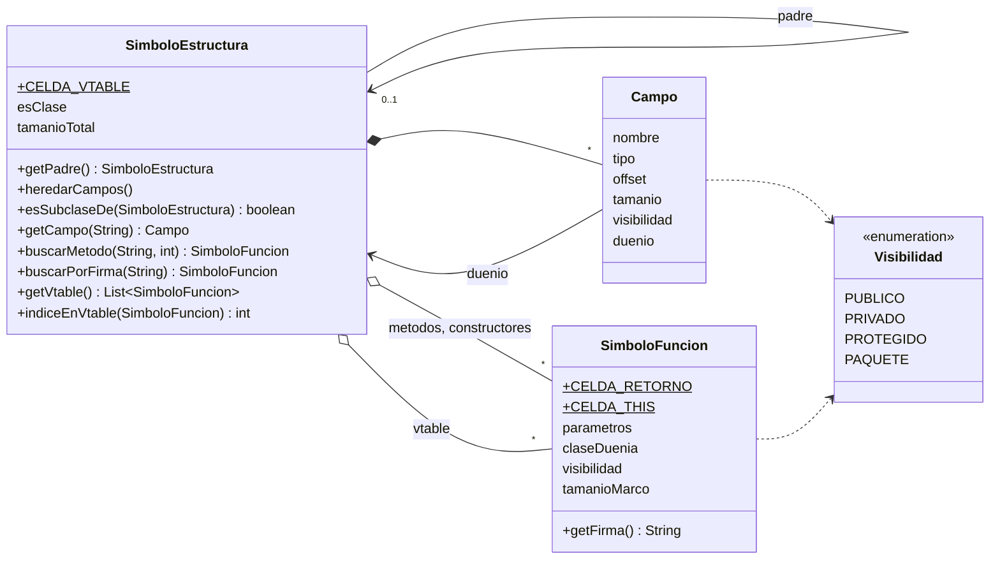
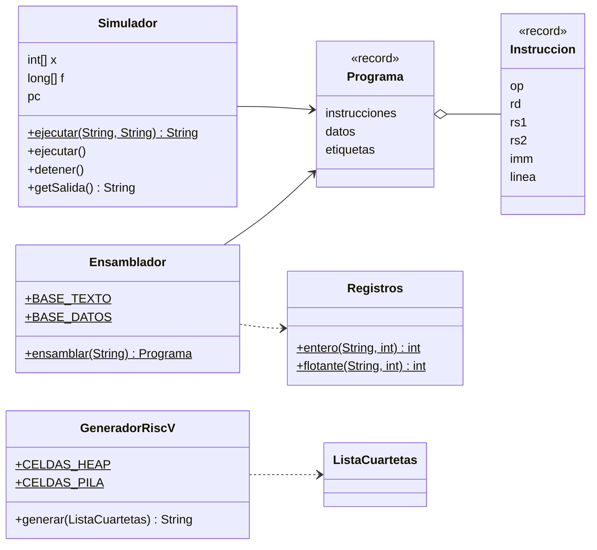
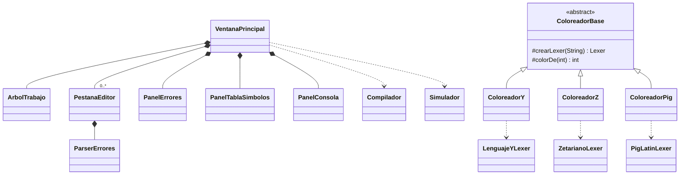

# Manual técnico — Contacto 3xtrat3rr3str3D

Proyecto 2 "St4ck Over-Pig" · Organización de Lenguajes y Compiladores 2 · USAC, Centro
Universitario de Occidente · Segundo semestre 2026

Compilador de tres lenguajes de alto nivel: **Y?** (`.y`), **Zetariano** (`.z`) y
**PigLatin** (`.pig`). Valida el programa (léxico, sintaxis y semántica) y genera **código de
tres direcciones con cuartetas**. Las cuartetas se traducen a **ensamblador RISC-V**
(RV32IMD, para RARS) y a **C**.

El Proyecto 2 agrega al del Proyecto 1:
- **Programación orientada a objetos en Zetariano:** herencia (`extends`), `protected`,
  `@Override`, `super` y despacho dinámico por vtable.
- **En PigLatin:** `null` y la declaración con tipo explícito.
- **Backend RISC-V:** el generador de ensamblador y un ensamblador con simulador propios, para
  ejecutar el `.s` dentro de la aplicación.

---

## 1. Tecnologías utilizadas

| Tecnología | Versión | Para qué |
|---|---|---|
| Java | 21 | Lenguaje del compilador y de la interfaz (se usa *pattern matching* en `switch` y `record`) |
| Maven | 3.9 | Construcción; genera los analizadores y arma un `.jar` ejecutable con todo adentro |
| ANTLR | 4.13.2 | Genera los lexers y parsers de los tres lenguajes (`antlr4-maven-plugin`) |
| Swing + FlatLaf | 3.5.4 | Interfaz gráfica con tema oscuro |
| RSyntaxTextArea | 3.5.4 | Componente de editor (números de línea, subrayado de errores). **No se usa su coloreado**: ver 6.3 |
| RISC-V RV32IMD | ISA | Destino del ensamblador generado: enteros (I), multiplicación (M) y doble precisión (D) |
| RARS | 1.6 | Simulador de referencia para el `.s`: se usa la convención de `ecall` de RARS (servicio en `a7`) |
| gcc | C11 | Compila el código C generado (solo para ejecutarlo; el compilador no lo necesita) |

El ensamblador y el simulador RISC-V que trae la aplicación (paquete `riscv`) están escritos
desde cero: no usan ninguna librería.

---

## 2. Arquitectura

La decisión central: **un solo AST para los tres lenguajes**. Cada lenguaje tiene su
gramática y su constructor, pero todos producen los mismos nodos; de ahí en adelante hay un
solo analizador semántico y un solo generador de cuartetas. Las cuartetas son la única entrada
de los tres backends: RISC-V, C y el intérprete.



Los backends sirven también para verificarse entre sí: un mismo programa da la misma salida en el
intérprete de cuartetas, en el simulador RISC-V y compilado con gcc (ver la sección de pruebas).

| Paquete | Contenido |
|---|---|
| `parser` (generado) | Lexers y parsers de ANTLR; `IndentacionY` convierte la indentación de Y? en `INDENT`/`DEDENT` |
| `errores` | `ListaErrores`, `ErrorCompilacion` y los *listeners* que traducen los errores de ANTLR al español |
| `ast` | Los 39 nodos (`declaraciones`, `instrucciones`, `expresiones`), `Tipo`, `Visibilidad` y la interfaz `Visitante` |
| `constructores` | `ConstructorAstY`, `ConstructorAstZ`, `ConstructorAstPig`: *parse tree* → AST común |
| `semantico` | `ResolvedorImports`, `AnalizadorSemantico`, `Compatibilidad` (reglas de tipos), `EvaluadorConstantes` |
| `simbolos` | `TablaSimbolos` con ámbitos, `SimboloVariable`, `SimboloFuncion`, `SimboloEstructura` (offsets, clase padre y vtable) |
| `c3d` | `Cuarteta`, `Operacion`, `ListaCuartetas`, `GeneradorCuartetas` e `InterpreteCuartetas` |
| `generador` | `GeneradorRiscV` (cuartetas → `.s`) y `TraductorC` (cuartetas → `.c`) |
| `riscv` | `Ensamblador` (`.s` → instrucciones y datos), `Instruccion`, `Registros` y `Simulador` |
| `ui` | Ventana, árbol de trabajo, editor, coloreadores propios, paneles de resultados; `DiagramaAst` (posiciones, dibujo y `.svg` del AST, sin librerías) y `PanelAst` (la pestaña con plegado y zoom) |
| (raíz) | `Main` (interfaz) y `Compilador` (orquesta todo; también se usa desde consola) |

---

## 3. Diagramas de clases

### 3.1 El compilador



### 3.2 El AST



`Instruccion` es **interfaz** porque hay nodos que son expresión e instrucción a la vez
(`calcular(10)` se usa por su valor o por su efecto). El diagrama muestra las clases
principales; la lista completa son los 39 métodos de `Visitante`.

Nodos y campos que agregó el Proyecto 2:
- `LlamadaSuper` es `super(args);`, una instrucción.
- `SuperMetodo` es `super.metodo(args)`, una expresión.
- `DeclaracionClase` guarda el nombre del padre.
- `DeclaracionMetodo`, `DeclaracionConstructor` y `DeclaracionVariable` guardan su
  `Visibilidad` (`PUBLICO`, `PRIVADO`, `PROTEGIDO` o `PAQUETE`, que es sin modificador).
  `DeclaracionMetodo` guarda además si lleva `@Override`.
- `null` y la declaración con tipo explícito de PigLatin no necesitan nodos nuevos: son un
  `Literal` de tipo `NULO` y una `DeclaracionVariable` con el tipo declarado.

### 3.3 La tabla de símbolos y la herencia



- **Campos:** cada clase empieza con una copia de los campos del padre (`heredarCampos`), con
  los mismos offsets, y agrega los suyos después. Así un `Perro` se puede usar donde se espera
  un `Animal`: los campos de `Animal` están en el mismo lugar. `duenio` es la clase que declaró
  el campo; se usa para decidir si un `private` o `protected` es accesible.
- **Vtable:** es una lista de métodos. Una clase copia la del padre, reemplaza en el mismo
  índice cada método que sobrescribe y agrega al final los métodos nuevos. Los `private` no
  entran.
- **Celdas de un objeto:** la celda 0 (`CELDA_VTABLE`) es la dirección de su vtable, así que
  los atributos empiezan en la celda 1. Las estructuras de Y? no tienen vtable y empiezan en 0.

### 3.4 El backend RISC-V



- **`GeneradorRiscV`:** traduce cada `funcion X:` de las cuartetas a una etiqueta `F_X`. Los
  temporales viven en el marco de la función, en la pila (`sp`).
- **`Ensamblador`:** lee el `.s` en dos pasadas: primero ubica las etiquetas, después decodifica
  cada instrucción. Expande las seudoinstrucciones (`li`, `la`, `call`, `ret`...) y resuelve
  las etiquetas de `.word` que aparecen más adelante en el archivo.
- **`Simulador`:** ejecuta las instrucciones y los `ecall` de RARS que usa el código generado.
  Tiene un límite de instrucciones y se puede detener desde la interfaz.

### 3.5 La interfaz



---

## 4. Especificación léxica y gramáticas

Las tres gramáticas están en `src/main/antlr4/com/usac/contacto3d/parser/`. En las tres:

- Espacios y comentarios van al **canal oculto** (`-> channel(HIDDEN)`), no a `skip`: el
  parser los ignora igual, pero el coloreado los necesita para pintar cada línea completa.
- La **precedencia** sale del orden de las alternativas de `expr` (la primera es la más
  alta): agrupación, unarios, `* / %`, `+ -`, relacionales, igualdad, `&&`, `||` y, en
  Zetariano, el ternario (asociativo a la derecha).
- **Todas las alternativas llevan etiqueta** (`# exprSumRes`), así ANTLR genera un método de
  visita por construcción.

**Literales comunes:** entero `[0-9]+`; decimal `[0-9]+ '.' [0-9]+`; cadena entre comillas
dobles con escapes `\n \t \" \\`; carácter entre comillas simples; identificador
`[a-zA-Z_][a-zA-Z0-9_]*`.

| | Comentario de línea | Comentario de bloque |
|---|---|---|
| Y? | `// ...` | `/* ... */` |
| Zetariano | `// ...` | `/* ... */` |
| PigLatin | `// ...` | `## ... ##` |

Las tablas de palabras y símbolos y las reglas de 4.2 a 4.4 se extrajeron de los `.g4` (sin las
etiquetas `# ...` ni las acciones), así que coinciden con lo que acepta el compilador.

**Lo que agregó el Proyecto 2:**

| Lenguaje | Palabra o símbolo | Regla | Ejemplo |
|---|---|---|---|
| Zetariano | `extends` | `clase` | `public class Perro extends Animal { ... }` |
| Zetariano | `protected` | `modificador` | `protected int patas;` |
| Zetariano | `@` `Override` | `anotacion`, antes del modificador de un método | `@Override public void hablar() { ... }` |
| Zetariano | `super` | `llamadaSuper` (instrucción) y `expr` | `super(nombre);` · `super.hablar();` · `"x" + super.tipo()` |
| PigLatin | `null` | `literal` | `esto p : null : Persona ;` · `si (p == null) { ... }` |
| PigLatin | `:` tipo | `declaracionVariable` | `esto a : novus Perro("Fido") : Animal ;` |

`Override` es palabra reservada, con mayúscula, igual que en Java. `null` ya existía en
Zetariano. Las restricciones de uso (dónde puede ir `super(...)`, a qué tipos se puede asignar
`null`, qué exige `@Override`) las aplica el semántico; ver la sección 6.

### 4.1 La indentación de Y?

Y? define los bloques con la indentación, como Python, y ANTLR no la maneja solo.
`IndentacionY` se mete entre el lexer y el parser y lleva una **pila de niveles**:

- al empezar una línea mide la sangría (un tab avanza al siguiente múltiplo de 4);
- si es mayor que el tope, apila y emite `INDENT`; si es menor, desapila y emite un
  `DEDENT` por cada nivel que cierra; al final del archivo cierra lo que quede abierto;
- las líneas vacías o con solo comentarios no cuentan;
- dentro de un literal `{ ... }` los saltos de línea se ignoran (matrices en varias líneas);
- una sangría que no coincide con ningún nivel es error léxico.

Así un bloque en la gramática es `NUEVA_LINEA INDENT instruccion+ DEDENT`.

### 4.2 Y? (`LenguajeY.g4`)

**Palabras reservadas y marcadores** (sensibles a mayusculas):

`%estructuras` `%funciones` `entero` `flotante` `cadena` `caracter` `bool` `estructura` `definir` `retornar` `si` `sino` `contrario` `entonces` `elegir` `caso` `siempre` `romper` `continuar` `para` `mientras` `hacer` `imprimir` `leer` `verdadero` `falso`

**Simbolos:**

| Token | Simbolo |
|---|---|
| `FLECHA` | `->` |
| `INCREMENTO` | `++` |
| `DECREMENTO` | `--` |
| `IGUALDAD` | `==` |
| `DIFERENTE` | `!=` |
| `MENOR_IGUAL` | `<=` |
| `MAYOR_IGUAL` | `>=` |
| `AND` | `&&` |
| `OR` | `&#124;&#124;` |
| `MAS` | `+` |
| `MENOS` | `-` |
| `POR` | `*` |
| `DIV` | `/` |
| `MENOR` | `<` |
| `MAYOR` | `>` |
| `NOT` | `!` |
| `ASIGNACION` | `=` |
| `PAR_A` | `(` |
| `PAR_C` | `)` |
| `CORCH_A` | `[` |
| `CORCH_C` | `]` |
| `LLAVE_A` | `{` |
| `LLAVE_C` | `}` |
| `PUNTO` | `.` |
| `COMA` | `,` |
| `DOSP` | `:` |
| `PUNTOYCOMA` | `;` |

<details><summary>Reglas sintacticas de Y?</summary>

```antlr
programa
    : (SEC_ESTRUCTURAS NUEVA_LINEA estructura*)?
      SEC_FUNCIONES NUEVA_LINEA funcion*
      EOF
    ;

estructura
    : ESTRUCTURA ID DOSP NUEVA_LINEA INDENT campo+ DEDENT
    ;

campo
    : tipo ID dimensionConstante* NUEVA_LINEA
    ;

dimensionConstante
    : CORCH_A LIT_ENTERO CORCH_C
    ;

funcion
    : DEFINIR ID PAR_A listaParametros? PAR_C (FLECHA tipo)? DOSP bloque
    ;

listaParametros
    : parametro (COMA parametro)*
    ;

parametro
    : tipo ID
    | (CORCH_A CORCH_C)+ tipo ID
    | LLAVE_A LLAVE_C ID ID
    ;

tipo
    : ENTERO
    | FLOTANTE
    | CADENA
    | CARACTER
    | BOOL
    | ID
    ;

bloque
    : NUEVA_LINEA INDENT instruccion+ DEDENT
    ;

instruccion
    : instruccionSimple PUNTOYCOMA? NUEVA_LINEA
    | estructura
    | sentenciaSi
    | sentenciaElegir
    | sentenciaPara
    | sentenciaMientras
    | sentenciaHacer
    | INDENT instruccion+ DEDENT
    ;

instruccionSimple
    : declaracion
    | asignacion
    | incremento
    | llamada
    | IMPRIMIR PAR_A listaExpresiones? PAR_C
    | LEER PAR_A PAR_C
    | RETORNAR expr?
    | ROMPER
    | CONTINUAR
    ;

declaracion
    : tipo ID dimension* (ASIGNACION expr)?
    ;

dimension
    : CORCH_A expr CORCH_C
    ;

asignacion
    : acceso ASIGNACION expr
    ;

incremento
    : acceso (INCREMENTO | DECREMENTO)
    ;

sentenciaSi
    : SI PAR_A expr PAR_C ENTONCES DOSP? bloque
      ramaSino*
      ramaContrario?
    ;

ramaSino
    : SINO PAR_A expr PAR_C ENTONCES DOSP? bloque
    ;

ramaContrario
    : CONTRARIO DOSP? bloque
    ;

sentenciaElegir
    : ELEGIR PAR_A expr PAR_C
      ( LLAVE_A NUEVA_LINEA (INDENT caso* casoSiempre? DEDENT)? LLAVE_C NUEVA_LINEA
      | DOSP NUEVA_LINEA (INDENT caso* casoSiempre? DEDENT)?
      )
    ;

caso
    : CASO expr DOSP cuerpoCaso
    ;

casoSiempre
    : SIEMPRE DOSP cuerpoCaso
    ;

cuerpoCaso
    : bloque
    | instruccionSimple PUNTOYCOMA? NUEVA_LINEA
    | NUEVA_LINEA
    ;

sentenciaPara
    : PARA PAR_A inicioPara PUNTOYCOMA expr PUNTOYCOMA actualizacionPara PAR_C DOSP bloque
    ;

inicioPara
    : declaracion
    | asignacion
    ;

actualizacionPara
    : incremento
    | asignacion
    ;

sentenciaMientras
    : MIENTRAS PAR_A expr PAR_C HACER DOSP? bloque
    ;

sentenciaHacer
    : HACER DOSP bloque MIENTRAS PAR_A expr PAR_C PUNTOYCOMA? NUEVA_LINEA
    ;

expr
    : PAR_A expr PAR_C
    | (MENOS | NOT) expr
    | expr (POR | DIV) expr
    | expr (MAS | MENOS) expr
    | expr (MENOR | MAYOR | MENOR_IGUAL | MAYOR_IGUAL) expr
    | expr (IGUALDAD | DIFERENTE) expr
    | expr AND expr
    | expr OR expr
    | literal
    | llamada
    | acceso
    | LEER PAR_A PAR_C
    | LLAVE_A listaExpresiones? LLAVE_C
    ;

listaExpresiones
    : expr (COMA expr)*
    ;

llamada
    : ID PAR_A listaExpresiones? PAR_C
    ;

acceso
    : ID sufijo*
    ;

sufijo
    : PUNTO ID
    | CORCH_A expr CORCH_C
    ;

literal
    : LIT_ENTERO
    | LIT_FLOTANTE
    | LIT_CADENA
    | LIT_CARACTER
    | (VERDADERO | FALSO)
    ;
```
</details>

### 4.3 Zetariano (`Zetariano.g4`)

**Palabras reservadas y marcadores** (sensibles a mayusculas):

`int` `double` `char` `boolean` `String` `void` `public` `private` `protected` `extends` `super` `Override` `class` `new` `this` `null` `true` `false` `if` `else` `switch` `case` `default` `break` `continue` `return` `for` `while` `do` `println` `print` `readln`

**Simbolos:**

| Token | Simbolo |
|---|---|
| `INCREMENTO` | `++` |
| `DECREMENTO` | `--` |
| `MAS_IGUAL` | `+=` |
| `MENOS_IGUAL` | `-=` |
| `POR_IGUAL` | `*=` |
| `IGUALDAD` | `==` |
| `DIFERENTE` | `!=` |
| `MENOR_IGUAL` | `<=` |
| `MAYOR_IGUAL` | `>=` |
| `AND` | `&&` |
| `OR` | `&#124;&#124;` |
| `MAS` | `+` |
| `MENOS` | `-` |
| `POR` | `*` |
| `DIV` | `/` |
| `MOD` | `%` |
| `MENOR` | `<` |
| `MAYOR` | `>` |
| `NOT` | `!` |
| `ASIGNACION` | `=` |
| `INTERROGACION` | `?` |
| `PAR_A` | `(` |
| `PAR_C` | `)` |
| `CORCH_A` | `[` |
| `CORCH_C` | `]` |
| `LLAVE_A` | `{` |
| `LLAVE_C` | `}` |
| `PUNTO` | `.` |
| `COMA` | `,` |
| `DOSP` | `:` |
| `PUNTOYCOMA` | `;` |
| `ARROBA` | `@` |

<details><summary>Reglas sintacticas de Zetariano</summary>

```antlr
programa
    : clase EOF
    ;

clase
    : modificador? CLASS ID (EXTENDS ID)? LLAVE_A miembro* LLAVE_C
    ;

modificador
    : PUBLIC
    | PRIVATE
    | PROTECTED
    ;

anotacion
    : ARROBA OVERRIDE
    ;

miembro
    : modificador? ID PAR_A listaParametros? PAR_C bloque
    | anotacion? modificador? VOID ID PAR_A listaParametros? PAR_C bloque
    | anotacion? modificador? tipo ID restoMiembro
    ;

restoMiembro
    : PAR_A listaParametros? PAR_C bloque
    | (ASIGNACION expr)? (COMA declarador)* PUNTOYCOMA
    ;

listaParametros
    : parametro (COMA parametro)*
    ;

parametro
    : tipo ID
    ;

tipo
    : tipoBase (CORCH_A CORCH_C)*
    ;

tipoBase
    : INT
    | DOUBLE
    | CHAR
    | BOOLEAN
    | STRING
    | ID
    ;

bloque
    : LLAVE_A instruccion* LLAVE_C
    ;

instruccion
    : bloque
    | declaracionVariable PUNTOYCOMA
    | asignacion PUNTOYCOMA
    | incremento PUNTOYCOMA
    | acceso PUNTOYCOMA
    | llamadaSuper PUNTOYCOMA
    | sentenciaIf
    | sentenciaSwitch
    | sentenciaFor
    | sentenciaWhile
    | sentenciaDoWhile
    | PRINTLN PAR_A expr? PAR_C PUNTOYCOMA
    | PRINT PAR_A expr PAR_C PUNTOYCOMA
    | READLN PAR_A PAR_C PUNTOYCOMA
    | BREAK PUNTOYCOMA
    | CONTINUE PUNTOYCOMA
    | RETURN expr? PUNTOYCOMA
    ;

declaracionVariable
    : tipo declarador (COMA declarador)*
    ;

declarador
    : ID (ASIGNACION expr)?
    ;

asignacion
    : acceso (ASIGNACION | MAS_IGUAL | MENOS_IGUAL | POR_IGUAL) expr
    ;

incremento
    : acceso (INCREMENTO | DECREMENTO)
    | (INCREMENTO | DECREMENTO) acceso
    ;

llamadaSuper
    : SUPER PAR_A listaExpresiones? PAR_C
    | SUPER PUNTO ID PAR_A listaExpresiones? PAR_C
    ;

sentenciaIf
    : IF PAR_A expr PAR_C instruccion (ELSE instruccion)?
    ;

sentenciaSwitch
    : SWITCH PAR_A expr PAR_C LLAVE_A seccionSwitch* LLAVE_C
    ;

seccionSwitch
    : CASE expr DOSP instruccion*
    | DEFAULT DOSP instruccion*
    ;

sentenciaFor
    : FOR PAR_A inicioFor? PUNTOYCOMA expr? PUNTOYCOMA listaActualizacion? PAR_C instruccion
    ;

inicioFor
    : declaracionVariable
    | listaActualizacion
    ;

listaActualizacion
    : actualizacion (COMA actualizacion)*
    ;

actualizacion
    : asignacion
    | incremento
    ;

sentenciaWhile
    : WHILE PAR_A expr PAR_C instruccion
    ;

sentenciaDoWhile
    : DO instruccion WHILE PAR_A expr PAR_C PUNTOYCOMA
    ;

expr
    : PAR_A expr PAR_C
    | incremento
    | (MENOS | NOT) expr
    | expr (POR | DIV | MOD) expr
    | expr (MAS | MENOS) expr
    | expr (MENOR | MAYOR | MENOR_IGUAL | MAYOR_IGUAL) expr
    | expr (IGUALDAD | DIFERENTE) expr
    | expr AND expr
    | expr OR expr
    | <assoc=right> expr INTERROGACION expr DOSP expr
    | literal
    | acceso
    | SUPER PUNTO ID PAR_A listaExpresiones? PAR_C
    | NEW ID PAR_A listaExpresiones? PAR_C
    | NEW tipoBase (CORCH_A expr CORCH_C)+
    | LLAVE_A listaExpresiones? LLAVE_C
    | READLN PAR_A PAR_C
    ;

listaExpresiones
    : expr (COMA expr)*
    ;

acceso
    : raizAcceso sufijo*
    ;

raizAcceso
    : ID PAR_A listaExpresiones? PAR_C
    | ID
    | THIS
    ;

sufijo
    : PUNTO ID PAR_A listaExpresiones? PAR_C
    | PUNTO ID
    | CORCH_A expr CORCH_C
    ;

literal
    : LIT_ENTERO
    | LIT_DECIMAL
    | LIT_CADENA
    | LIT_CARACTER
    | (TRUE | FALSE)
    | NULL
    ;
```
</details>

### 4.4 PigLatin (`PigLatin.g4`)

**Palabras reservadas y marcadores** (sensibles a mayusculas):

`VARIABILES>` `MUNERA>` `MAIOR>` `VARIABILES[` `FINIS` `numerus` `decimalis` `textum` `littera` `bool` `import` `esto` `structura` `series` `novus` `finis` `si` `aliter` `dum` `facere` `per` `perge` `interrumpe` `actio` `ratio` `reddere` `verum` `falsus` `null` `non`

**Simbolos:**

| Token | Simbolo |
|---|---|
| `IMPRIMIR` | `>>` |
| `LEER` | `<<` |
| `INCREMENTO` | `++` |
| `DECREMENTO` | `--` |
| `IGUALDAD` | `==` |
| `DIFERENTE` | `!=` |
| `MENOR_IGUAL` | `<=` |
| `MAYOR_IGUAL` | `>=` |
| `AND` | `&&` |
| `OR` | `&#124;&#124;` |
| `MAS` | `+` |
| `MENOS` | `-` |
| `POR` | `*` |
| `DIV` | `/` |
| `MENOR` | `<` |
| `MAYOR` | `>` |
| `ASIGNACION` | `=` |
| `PAR_A` | `(` |
| `PAR_C` | `)` |
| `CORCH_A` | `[` |
| `CORCH_C` | `]` |
| `LLAVE_A` | `{` |
| `LLAVE_C` | `}` |
| `PUNTO` | `.` |
| `COMA` | `,` |
| `DOSP` | `:` |
| `PUNTOYCOMA` | `;` |

<details><summary>Reglas sintacticas de PigLatin</summary>

```antlr
programa
    : importacion*
      (SEC_VARIABILES declaracion*)?
      (SEC_MUNERA funcion*)?
      SEC_MAIOR instruccion* FINIS_MAIOR PUNTOYCOMA
      EOF
    ;

importacion
    : IMPORT ID (PUNTO ID)+ PUNTOYCOMA?
    ;

declaracion
    : declaracionVariable
    | declaracionArreglo
    | STRUCTURA ID LLAVE_A declaracion* LLAVE_C FINIS PUNTOYCOMA
    ;

declaracionVariable
    : ESTO ID DOSP tipoPrimitivo expr? PUNTOYCOMA
    | ESTO ID DOSP (VERUM | FALSUS) PUNTOYCOMA
    | ESTO ID DOSP ID listaValores PUNTOYCOMA?
    | ESTO ID DOSP ID PUNTOYCOMA
    | ESTO ID DOSP nuevoObjeto PUNTOYCOMA
    | ESTO ID DOSP expr DOSP tipo PUNTOYCOMA
    ;

declaracionArreglo
    : SERIES ID dimension+ DOSP tipo (listaValores PUNTOYCOMA? | PUNTOYCOMA)
    ;

dimension
    : CORCH_A expr CORCH_C
    ;

listaValores
    : LLAVE_A (valor (COMA valor)*)? LLAVE_C
    ;

valor
    : expr
    | listaValores
    ;

tipo
    : tipoPrimitivo
    | ID
    ;

tipoPrimitivo
    : NUMERUS
    | DECIMALIS
    | TEXTUM
    | LITTERA
    | BOOL
    ;

funcion
    : ACTIO ID PAR_A listaParametros? PAR_C cuerpoFuncion
    | RATIO tipo ID PAR_A listaParametros? PAR_C cuerpoFuncion
    ;

listaParametros
    : parametro (COMA parametro)*
    ;

parametro
    : ESTO ID DOSP tipo
    ;

cuerpoFuncion
    : LLAVE_A bloqueVariables? instruccion* LLAVE_C FINIS PUNTOYCOMA
    ;

bloqueVariables
    : VAR_BLOQUE declaracion* CORCH_C
    ;

instruccion
    : declaracionVariable
    | declaracionArreglo
    | asignacion
    | incremento PUNTOYCOMA
    | acceso PUNTOYCOMA
    | sentenciaSi
    | sentenciaDum
    | sentenciaFacere
    | sentenciaPer
    | PERGE PUNTOYCOMA
    | INTERRUMPE PUNTOYCOMA
    | REDDERE expr? PUNTOYCOMA
    | IMPRIMIR expr (IMPRIMIR expr)* PUNTOYCOMA
    | acceso LEER PUNTOYCOMA?
    | LEER PUNTOYCOMA?
    ;

asignacion
    : acceso ASIGNACION expr PUNTOYCOMA
    | acceso ASIGNACION listaValores PUNTOYCOMA?
    ;

incremento
    : acceso (INCREMENTO | DECREMENTO)
    ;

sentenciaSi
    : SI PAR_A expr PAR_C bloque ramaAliterSi* ramaAliter? FINIS PUNTOYCOMA
    ;

ramaAliterSi
    : ALITER PAR_A expr PAR_C bloque
    ;

ramaAliter
    : ALITER bloque
    ;

sentenciaDum
    : DUM PAR_A expr PAR_C bloque FINIS PUNTOYCOMA
    ;

sentenciaFacere
    : FACERE bloque DUM PAR_A expr PAR_C PUNTOYCOMA
    ;

sentenciaPer
    : PER PAR_A inicioPer PUNTOYCOMA expr PUNTOYCOMA actualizacionPer PAR_C bloque
      (FINIS PUNTOYCOMA?)?
    ;

inicioPer
    : ESTO ID DOSP tipo expr
    | acceso ASIGNACION expr
    ;

actualizacionPer
    : incremento
    | acceso ASIGNACION expr
    ;

bloque
    : LLAVE_A instruccion* LLAVE_C
    ;

expr
    : PAR_A expr PAR_C
    | incremento
    | (MENOS | NON) expr
    | expr (POR | DIV) expr
    | expr (MAS | MENOS) expr
    | expr (MENOR | MAYOR | MENOR_IGUAL | MAYOR_IGUAL) expr
    | expr (IGUALDAD | DIFERENTE) expr
    | expr AND expr
    | expr OR expr
    | literal
    | acceso
    | nuevoObjeto
    ;

nuevoObjeto
    : NOVUS ID PAR_A listaExpresiones? PAR_C
    ;

listaExpresiones
    : expr (COMA expr)*
    ;

acceso
    : raizAcceso sufijo*
    ;

raizAcceso
    : ID PAR_A listaExpresiones? PAR_C
    | ID
    ;

sufijo
    : PUNTO ID PAR_A listaExpresiones? PAR_C
    | PUNTO ID
    | CORCH_A expr CORCH_C
    ;

literal
    : LIT_ENTERO
    | LIT_DECIMAL
    | LIT_CADENA
    | LIT_CARACTER
    | (VERUM | FALSUS)
    | NULL
    ;
```
</details>

---

## 5. Tabla de compatibilidad de tipos

Se genera a partir de `semantico/Compatibilidad`, la misma clase que usa el analizador, así que
no puede diferir de lo que el compilador hace. Para regenerarla:

```bash
java -cp target/contacto-3d-1.0.0.jar com.usac.contacto3d.semantico.TablaCompatibilidad
```

Las reglas son las mismas en los tres lenguajes; solo cambian los nombres de los tipos.

**Jerarquía** (al operar gana la más alta): cadena 5 > flotante 4 > entero 3 > carácter 2 > bool 1.
Asignar solo puede **ampliar** dentro de la familia numérica (carácter → entero → flotante); bool y
cadena exigen el mismo tipo. Los objetos, la herencia y `null` están en 5.4.

### 5.1 Y?

**Suma `+` (con una cadena, concatena)** — fila: operando izquierdo, columna: operando derecho

| | **entero** | **flotante** | **cadena** | **caracter** | **bool** |
|---|---|---|---|---|---|
| **entero** | entero | flotante | cadena | entero | entero |
| **flotante** | flotante | flotante | cadena | flotante | flotante |
| **cadena** | cadena | cadena | cadena | cadena | cadena |
| **caracter** | entero | flotante | cadena | caracter | caracter |
| **bool** | entero | flotante | cadena | caracter | bool |

**Resta, multiplicacion y division `-` `*` `/`** — fila: operando izquierdo, columna: operando derecho

| | **entero** | **flotante** | **cadena** | **caracter** | **bool** |
|---|---|---|---|---|---|
| **entero** | entero | flotante | error | entero | entero |
| **flotante** | flotante | flotante | error | flotante | flotante |
| **cadena** | error | error | error | error | error |
| **caracter** | entero | flotante | error | caracter | caracter |
| **bool** | entero | flotante | error | caracter | bool |

**Relacionales `<` `>` `<=` `>=`** — fila: operando izquierdo, columna: operando derecho

| | **entero** | **flotante** | **cadena** | **caracter** | **bool** |
|---|---|---|---|---|---|
| **entero** | bool | bool | error | bool | bool |
| **flotante** | bool | bool | error | bool | bool |
| **cadena** | error | error | error | error | error |
| **caracter** | bool | bool | error | bool | bool |
| **bool** | bool | bool | error | bool | bool |

**Igualdad `==` `!=`** — fila: operando izquierdo, columna: operando derecho

| | **entero** | **flotante** | **cadena** | **caracter** | **bool** |
|---|---|---|---|---|---|
| **entero** | bool | bool | error | bool | bool |
| **flotante** | bool | bool | error | bool | bool |
| **cadena** | error | error | bool | error | error |
| **caracter** | bool | bool | error | bool | bool |
| **bool** | bool | bool | error | bool | bool |

**Logicos `&&` `||` (negacion: `!`)** — fila: operando izquierdo, columna: operando derecho

| | **entero** | **flotante** | **cadena** | **caracter** | **bool** |
|---|---|---|---|---|---|
| **entero** | error | error | error | error | error |
| **flotante** | error | error | error | error | error |
| **cadena** | error | error | error | error | error |
| **caracter** | error | error | error | error | error |
| **bool** | error | error | error | error | bool |

**Asignacion, paso de parametros y retorno** — fila: tipo del destino, columna: tipo del valor

| destino \ valor | **entero** | **flotante** | **cadena** | **caracter** | **bool** |
|---|---|---|---|---|---|
| **entero** | si | no (pierde informacion) | no | si | no |
| **flotante** | si | si | no | si | no |
| **cadena** | no | no | si | no | no |
| **caracter** | no (pierde informacion) | no (pierde informacion) | no | si | no |
| **bool** | no | no | no | no | si |

### 5.2 Zetariano

**Suma `+` (con una cadena, concatena)** — fila: operando izquierdo, columna: operando derecho

| | **int** | **double** | **String** | **char** | **boolean** |
|---|---|---|---|---|---|
| **int** | int | double | String | int | int |
| **double** | double | double | String | double | double |
| **String** | String | String | String | String | String |
| **char** | int | double | String | char | char |
| **boolean** | int | double | String | char | boolean |

**Resta, multiplicacion y division `-` `*` `/`** — fila: operando izquierdo, columna: operando derecho

| | **int** | **double** | **String** | **char** | **boolean** |
|---|---|---|---|---|---|
| **int** | int | double | error | int | int |
| **double** | double | double | error | double | double |
| **String** | error | error | error | error | error |
| **char** | int | double | error | char | char |
| **boolean** | int | double | error | char | boolean |

**Modulo `%`** — fila: operando izquierdo, columna: operando derecho

| | **int** | **double** | **String** | **char** | **boolean** |
|---|---|---|---|---|---|
| **int** | int | error | error | int | error |
| **double** | error | error | error | error | error |
| **String** | error | error | error | error | error |
| **char** | int | error | error | int | error |
| **boolean** | error | error | error | error | error |

**Relacionales `<` `>` `<=` `>=`** — fila: operando izquierdo, columna: operando derecho

| | **int** | **double** | **String** | **char** | **boolean** |
|---|---|---|---|---|---|
| **int** | boolean | boolean | error | boolean | boolean |
| **double** | boolean | boolean | error | boolean | boolean |
| **String** | error | error | error | error | error |
| **char** | boolean | boolean | error | boolean | boolean |
| **boolean** | boolean | boolean | error | boolean | boolean |

**Igualdad `==` `!=`** — fila: operando izquierdo, columna: operando derecho

| | **int** | **double** | **String** | **char** | **boolean** |
|---|---|---|---|---|---|
| **int** | boolean | boolean | error | boolean | boolean |
| **double** | boolean | boolean | error | boolean | boolean |
| **String** | error | error | boolean | error | error |
| **char** | boolean | boolean | error | boolean | boolean |
| **boolean** | boolean | boolean | error | boolean | boolean |

**Logicos `&&` `||` (negacion: `!`)** — fila: operando izquierdo, columna: operando derecho

| | **int** | **double** | **String** | **char** | **boolean** |
|---|---|---|---|---|---|
| **int** | error | error | error | error | error |
| **double** | error | error | error | error | error |
| **String** | error | error | error | error | error |
| **char** | error | error | error | error | error |
| **boolean** | error | error | error | error | boolean |

**Asignacion, paso de parametros y retorno** — fila: tipo del destino, columna: tipo del valor

| destino \ valor | **int** | **double** | **String** | **char** | **boolean** |
|---|---|---|---|---|---|
| **int** | si | no (pierde informacion) | no | si | no |
| **double** | si | si | no | si | no |
| **String** | no | no | si | no | no |
| **char** | no (pierde informacion) | no (pierde informacion) | no | si | no |
| **boolean** | no | no | no | no | si |

### 5.3 PigLatin

**Suma `+` (con una cadena, concatena)** — fila: operando izquierdo, columna: operando derecho

| | **numerus** | **decimalis** | **textum** | **littera** | **bool** |
|---|---|---|---|---|---|
| **numerus** | numerus | decimalis | textum | numerus | numerus |
| **decimalis** | decimalis | decimalis | textum | decimalis | decimalis |
| **textum** | textum | textum | textum | textum | textum |
| **littera** | numerus | decimalis | textum | littera | littera |
| **bool** | numerus | decimalis | textum | littera | bool |

**Resta, multiplicacion y division `-` `*` `/`** — fila: operando izquierdo, columna: operando derecho

| | **numerus** | **decimalis** | **textum** | **littera** | **bool** |
|---|---|---|---|---|---|
| **numerus** | numerus | decimalis | error | numerus | numerus |
| **decimalis** | decimalis | decimalis | error | decimalis | decimalis |
| **textum** | error | error | error | error | error |
| **littera** | numerus | decimalis | error | littera | littera |
| **bool** | numerus | decimalis | error | littera | bool |

**Relacionales `<` `>` `<=` `>=`** — fila: operando izquierdo, columna: operando derecho

| | **numerus** | **decimalis** | **textum** | **littera** | **bool** |
|---|---|---|---|---|---|
| **numerus** | bool | bool | error | bool | bool |
| **decimalis** | bool | bool | error | bool | bool |
| **textum** | error | error | error | error | error |
| **littera** | bool | bool | error | bool | bool |
| **bool** | bool | bool | error | bool | bool |

**Igualdad `==` `!=`** — fila: operando izquierdo, columna: operando derecho

| | **numerus** | **decimalis** | **textum** | **littera** | **bool** |
|---|---|---|---|---|---|
| **numerus** | bool | bool | error | bool | bool |
| **decimalis** | bool | bool | error | bool | bool |
| **textum** | error | error | bool | error | error |
| **littera** | bool | bool | error | bool | bool |
| **bool** | bool | bool | error | bool | bool |

**Logicos `&&` `||` (negacion: `non`)** — fila: operando izquierdo, columna: operando derecho

| | **numerus** | **decimalis** | **textum** | **littera** | **bool** |
|---|---|---|---|---|---|
| **numerus** | error | error | error | error | error |
| **decimalis** | error | error | error | error | error |
| **textum** | error | error | error | error | error |
| **littera** | error | error | error | error | error |
| **bool** | error | error | error | error | bool |

**Asignacion, paso de parametros y retorno** — fila: tipo del destino, columna: tipo del valor

| destino \ valor | **numerus** | **decimalis** | **textum** | **littera** | **bool** |
|---|---|---|---|---|---|
| **numerus** | si | no (pierde informacion) | no | si | no |
| **decimalis** | si | si | no | si | no |
| **textum** | no | no | si | no | no |
| **littera** | no (pierde informacion) | no (pierde informacion) | no | si | no |
| **bool** | no | no | no | no | si |

### 5.4 Objetos, herencia y `null`

Para las clases de Zetariano usadas desde Zetariano o desde PigLatin. Las clases de ejemplo:
`Perro extends Animal`, `Gato extends Animal` y `Persona`, sin relacion con las otras.
`int[]` es cualquier arreglo, `String` la cadena del lenguaje (`textum` en PigLatin) e `int`
cualquier primitivo.

**Asignacion, paso de parametros y retorno** — fila: tipo del destino, columna: tipo del valor

| destino \ valor | **Animal** | **Perro** | **Gato** | **Persona** | **int[]** | **String** | **int** | **null** |
|---|---|---|---|---|---|---|---|---|
| **Animal** | si | si | si | no | no | no | no | si |
| **Perro** | no | si | no | no | no | no | no | si |
| **Gato** | no | no | si | no | no | no | no | si |
| **Persona** | no | no | no | si | no | no | no | si |
| **int[]** | no | no | no | no | si | no | no | si |
| **String** | no | no | no | no | no | si | no | no |
| **int** | no | no | no | no | no | no | si | no |

**Igualdad `==` `!=`** — fila: operando izquierdo, columna: operando derecho

| | **Animal** | **Perro** | **Gato** | **Persona** | **int[]** | **String** | **int** | **null** |
|---|---|---|---|---|---|---|---|---|
| **Animal** | boolean | boolean | boolean | error | error | error | error | boolean |
| **Perro** | boolean | boolean | error | error | error | error | error | boolean |
| **Gato** | boolean | error | boolean | error | error | error | error | boolean |
| **Persona** | error | error | error | boolean | error | error | error | boolean |
| **int[]** | error | error | error | error | boolean | error | error | boolean |
| **String** | error | error | error | error | error | boolean | error | error |
| **int** | error | error | error | error | error | error | boolean | error |
| **null** | boolean | boolean | boolean | boolean | boolean | error | error | boolean |

**Otras operaciones con objetos:** `String + Animal` da error y `Animal - Animal` da error. Un objeto solo se usa con `==`, `!=`, `.atributo` y `.metodo()`.

En resumen:
- Una variable del tipo padre acepta un objeto de cualquier subclase, directa o indirecta. Al
  revés no: un `Animal` no se puede guardar en un `Perro`.
- Dos objetos se pueden comparar si uno es de la clase del otro o de una subclase. Dos hermanas
  (`Perro` y `Gato`) no.
- `null` se puede asignar y comparar solo con objetos y arreglos; con ningún primitivo, ni
  siquiera con la cadena.
- Las mismas reglas valen para los parámetros, el `return` y el tipo de retorno de un método
  sobrescrito (retorno covariante).


---

## 6. Análisis semántico

### 6.1 Validaciones

| Categoría | Qué se reporta |
|---|---|
| Declaraciones | variable, función, clase o tipo no declarado; redeclaración en el mismo ámbito; campo o atributo repetido; función, método o constructor con firma repetida; estructura que se contiene a sí misma |
| Tipos | asignación incompatible o que pierde información; operación inválida (la cadena solo admite `+`); condición no booleana en `si`, ciclos y ternario; ramas del ternario incompatibles |
| Accesos | campo o atributo inexistente; acceso a miembro de algo que no es estructura ni objeto; índice constante fuera de rango; cantidad de índices distinta a las dimensiones |
| Llamadas | cantidad o tipo de argumentos; método o constructor inexistente con esa firma; `{} Estructura` que no recibe una variable |
| Flujo | función que no retorna en todos los caminos; retorno de tipo incorrecto; código inalcanzable; `romper`/`continuar` fuera de un ciclo |
| Archivos | import inexistente o de extensión inválida; `.z` que no se llama como su clase |
| Herencia | clase padre inexistente o que es una estructura; herencia circular (`A extends B`, `B extends A`); atributo que repite el nombre de uno heredado |
| Visibilidad | acceso a un miembro `private` o sin modificador fuera de su clase; acceso a un `protected` fuera de su clase y sus subclases |
| `@Override` | método que sobrescribe sin `@Override`; `@Override` sin método que sobrescribir o sobre un atributo; reducir la visibilidad; tipo de retorno que no es el mismo ni una subclase |
| `super` | `super(...)` fuera de un constructor o que no es su primera instrucción; `super` en una clase sin padre; `super.m()` a un método que el padre no tiene; constructor sin `super(...)` cuando el padre no tiene constructor sin parámetros accesible |
| `null` | asignar `null` a un primitivo (incluida la cadena); operar, imprimir o comparar `null` con un primitivo |

Un error se reporta **una sola vez**, donde nace: tras un error la expresión vale
`Tipo.ERROR`, que se acepta en silencio más arriba.

**Un `.z` analizado solo.** Zetariano no tiene `import`: una clase conoce a las demás solo
cuando un `.pig` las importa. Para que un `.z` se pueda analizar por separado (la interfaz
compila la pestaña activa), `Compilador.conClasesVecinas` carga también los otros `.z` de su
carpeta, cada uno parseado con su propia lista de errores; los que no parsean se ignoran. El
semántico corre sobre todos, pero solo se reportan los errores del `.z` analizado. Así,
`Banco.z` solo da 0 errores en vez de "El tipo 'Cuenta' no esta declarado".

### 6.2 Herencia, visibilidad y `super`

**Quién puede usar un miembro** (atributo, método o constructor):

| Modificador | Dentro de su clase | En una subclase | En otra clase o en el `.pig` |
|---|---|---|---|
| `public` | sí | sí | sí |
| `protected` | sí | sí | no |
| `private` | sí | no | no |
| (sin modificador) | sí | no | no |

**Sin modificador es `private`.** Así lo confirmó el auxiliar para el Proyecto 2. Los casos de
calificación del Proyecto 1 leen atributos sin modificador desde fuera de su clase, así que con
esta regla dan errores de acceso. `verificacion/casos/` tiene una copia con `public` agregado
(ver `verificacion/README.md`).

**Orden en que el semántico procesa las clases:**
1. **Enlaza cada clase con su padre** y corta los ciclos, para que una herencia circular dé un
   solo error y no un ciclo infinito.
2. **Completa las clases de padre a hijo:** cada una hereda los campos del padre con los mismos
   offsets (ver 3.3) y después agrega los suyos.
3. **Valida `@Override`:** un método sobrescribe a otro del padre (o de un ancestro) cuando
   tiene el mismo nombre y los mismos tipos de parámetros. En los dos sentidos es obligatorio:
   - el que sobrescribe debe llevar `@Override`;
   - un `@Override` sin método que sobrescribir es error.

   Además:
   - el retorno puede ser el mismo tipo o una subclase (covariante);
   - la visibilidad no puede bajar (`public` → `protected` es error);
   - los métodos `private` del padre no se heredan, así que un método con el mismo nombre en la
     hija es un método nuevo, sin `@Override`.
4. **Arma la vtable** de cada clase (ver 3.3 y 7.1).

**Constructores:**
- `super(args)` solo puede ser la primera instrucción de un constructor.
- Si el constructor de la hija no llama a `super`, se llama al constructor sin parámetros del
  padre. Si el padre no tiene uno, o no es accesible, es error.
- Primero corre el constructor del padre y después los inicializadores de los atributos de la
  hija, así que en `Cachorro extends Perro extends Animal` el orden es `Animal`, `Perro`,
  `Cachorro`.

**`super.metodo(args)`** llama siempre a la versión del padre, sin pasar por la vtable. Así un
método sobrescrito puede extender al del padre sin llamarse a sí mismo.

### 6.3 Por qué el coloreado no usa librerías

El enunciado prohíbe librerías para colorear. RSyntaxTextArea solo se usa como componente
de texto: `ColoreadorBase.getWordsToHighlight()` devuelve un mapa **vacío** a propósito, y el
tipo de cada palabra lo decide el **lexer de ANTLR del propio compilador**
(`ColoreadorY` → `LenguajeYLexer`, etc.). Por eso el editor colorea exactamente lo mismo que
el compilador reconoce, y un carácter inválido sale en rojo porque el lexer no lo acepta.

---

## 7. Modelo de memoria

| Zona | Qué guarda |
|---|---|
| `stack` | Globales de `VARIABILES>` en el fondo (`[0, G)`); después un **marco** por cada llamada activa |
| `heap` | Cadenas, arreglos y objetos. `H` solo avanza |
| `P` | Base del marco de la función que se está ejecutando |
| `H` | Primera celda libre del heap |

**Marco de una función:** `[0]` valor de retorno · `[1]` `this` (métodos y constructores) ·
parámetros · variables locales. El semántico asigna la posición de cada símbolo y el tamaño
del marco (`SimboloFuncion.getTamanioMarco()`); cada llamada trabaja en su propio tramo, y
por eso la recursividad funciona.

| Valor | Representación |
|---|---|
| Entero, flotante, carácter, bool | Una celda (`double`); el carácter es su código, el bool 0 o 1 |
| Cadena | Puntero al heap: un carácter por celda terminado en `-1`. `heap[0]` es la cadena vacía |
| Arreglo | Puntero al heap: primero sus dimensiones y después los datos **aplanados** por filas: `m[i][j]` está en `p + rango + (i*d2 + j) * tamañoElemento` |
| Estructura | Sus campos **aplanados** donde esté la variable (stack, global o dentro de un arreglo); un campo es un desplazamiento |
| Objeto | Puntero al heap. La celda 0 es la dirección de la vtable de su clase; los atributos van seguidos desde la celda 1, primero los heredados |
| `null` | 0. Ningún objeto vive en la dirección 0, así que no se confunde con una referencia válida |
| Parámetro `{}` / `[]` | Por referencia: la celda guarda la dirección |

**Una llamada:** se evalúan los argumentos en el marco actual, se escriben en
`stack[P + marcoActual + posición]`, `P` avanza, `call`, se lee el retorno de `stack[P]` y `P`
vuelve.

**Orden del heap** al empezar `main`:

| Celdas | Contenido |
|---|---|
| `heap[0]` | `-1`: la cadena vacía |
| `heap[1 ..]` | Las vtables de todas las clases, una detrás de otra |
| después | Las cadenas literales del programa |
| desde `H` | Lo que se crea al ejecutar: objetos, arreglos y cadenas nuevas |

### 7.1 Vtables y despacho dinámico

Una vtable es una fila de celdas con el **número de función** de cada método. El número de una
función es su posición en `ListaCuartetas.getFunciones()`. Con las clases de
`entradas/polimorfismo/` (`ImpresoraPDF extends Impresora`, `ImpresoraColor extends ImpresoraPDF`):

| Índice | `Impresora` (heap 1–3) | `ImpresoraPDF` (heap 4–7) | `ImpresoraColor` (heap 11–14) |
|---|---|---|---|
| 0 | `Impresora_imprimir` | `ImpresoraPDF_imprimir` | `ImpresoraColor_imprimir` |
| 1 | `Impresora_trabajo` | `Impresora_trabajo` | `Impresora_trabajo` |
| 2 | `Impresora_tipo` | `ImpresoraPDF_tipo` | `ImpresoraColor_tipo` |
| 3 | | `ImpresoraPDF_comprimir` | `ImpresoraPDF_comprimir` |

- **Cómo se arma:** la hija copia la vtable del padre, reemplaza las entradas que sobrescribe
  en el mismo índice y agrega al final sus métodos nuevos. Así, un mismo método tiene el mismo
  índice en toda la jerarquía.
- **Quién la llena:** `main` la escribe al empezar, antes de las cadenas literales:
  ```
  t169 = &Impresora_imprimir      # numero de la funcion
  heap[1] = t169
  ```
- **El objeto:** `novus`/`new` escribe en la celda 0 del objeto nuevo la dirección de la vtable
  de su clase.
- **Una llamada `obj.imprimir()`:** si el objeto es `null` es un error de ejecución. Si no, lee
  la vtable del objeto **en ejecución**, toma la entrada del índice del método y salta a ella:
  ```
  t20 = heap[t16]        # vtable del objeto (celda 0)
  t21 = heap[t20]        # entrada 0: imprimir
  P = P + 2
  call_indirecto t21
  P = P - 2
  ```
  Por eso una variable `Impresora` que guarda una `ImpresoraColor` ejecuta
  `ImpresoraColor_imprimir`. Lo mismo vale para `this.m()` y `m()` dentro de un método: en
  `trabajo()`, escrito solo en `Impresora`, `this.imprimir()` llama al de la clase real.

**Solo cuando hace falta:** un método se llama por la vtable únicamente si alguna subclase lo
sobrescribe. Los demás son llamadas directas (`call`):
- los métodos que no se sobrescriben,
- los `private`,
- los constructores,
- `super.m()`, que llama siempre a la versión del padre.

Así, un programa sin herencia genera exactamente las mismas cuartetas que en el Proyecto 1.

---

## 8. Cuartetas

Cada cuarteta es `(operación, arg1, arg2, resultado)`. Se muestran en forma legible:

| Operación | Forma | Traducción a C |
|---|---|---|
| `ASIGNAR` | `t1 = a` | `t1 = a;` |
| `SUMA` `RESTA` `MULTIPLICACION` | `t1 = a + b` | `t1 = a + b;` |
| `DIVISION`, `DIVISION_ENTERA`, `MODULO` | `t1 = a / b`, `t1 = a div b`, `t1 = a % b` | `dividir(a, b)`, `dividir_entero(a, b)`, `modulo(a, b)` (verifican el cero) |
| `NEGATIVO`, `NOT` | `t1 = -a`, `t1 = !a` | `-(a)`, `(a == 0)` |
| Relacionales | `t1 = a < b` | `t1 = (a < b);` |
| `LEER_STACK`, `ESCRIBIR_STACK` | `t1 = stack[a]`, `stack[a] = b` | `stack[(int) a]` |
| `LEER_HEAP`, `ESCRIBIR_HEAP` | `t1 = heap[a]`, `heap[a] = b` | `heap[(int) a]` |
| `ETIQUETA`, `GOTO` | `L1:`, `goto L1` | `L1: ;`, `goto L1;` |
| `IF_TRUE`, `IF_FALSE` | `if t1 goto L1`, `if_false t1 goto L1` | `if (t1 != 0) goto L1;`, `if (t1 == 0) goto L1;` |
| `FUNCION`, `FIN_FUNCION` | `funcion f:` … `fin f` | `void f_f(void) { ... }` |
| `CALL`, `RETURN`, `HALT` | `call f`, `return`, `halt` | `f_f();`, `return;`, `return 0;` |
| `DIRECCION_FUNCION` | `t1 = &f` | `t1 = 7;` (el número de la función) |
| `CALL_INDIRECTO` | `call_indirecto t1` | `llamar_indirecto(t1);` |
| `IMPRIMIR`, `SALTO_LINEA` | `print t1 (entero)` | `imprimir_entero(t1);` … |
| `LEER_CADENA`, `CONVERTIR_CADENA` | `t1 = leer`, `t2 = convertir t1 (entero)` | `leer_cadena()`, `convertir_entero(t1)` |
| `CONCATENAR`, `A_CADENA`, `IGUAL_CADENAS` | `t3 = concatenar t1, t2` | `concatenar(t1, t2)` … |
| `ERROR_EJECUCION` | `error t1` | `error_ejecucion(t1);` (imprime y termina) |

Patrones que genera `GeneradorCuartetas`:

```
si (c) {A} sino {B}          mientras (c) {cuerpo}         elegir(v) con fall-through
    if_false c goto L1       L0: if_false c goto L1           t = v == c1; if t goto La
    ...A...                      ...cuerpo...                 t = v == c2; if t goto Lb
    goto L0                      goto L0                      goto Ldefault
L1: ...B...                  L1:                           La: ...   (sin romper sigue a Lb)
L0:                                                        Lb: ...   romper -> goto Lfin
```

`&&` y `||` se evalúan en **cortocircuito**. Los accesos a arreglos verifican el índice y
los accesos a objetos (`.atributo`, `.metodo()` e índices) verifican `null` en tiempo de
ejecución, con un mensaje que dice archivo, línea y qué se intentó usar:

```
Error de ejecucion en prueba_acceso_nulo.pig linea 9: referencia nula: se intento usar el metodo 'getNombre()' sobre null
```

---

## 9. Traducción a C

`TraductorC` convierte cada `funcion X: … fin X` en una **función de C** con sus temporales
como variables **locales** (así una llamada recursiva no pisa los temporales pendientes de
quien la hizo) y antepone una plantilla con `stack`, `heap`, `P`, `H` y las funciones del
sistema (imprimir, concatenar, leer, convertir). El resultado compila sin advertencias con
`gcc -std=c11 -Wall -Wextra -pedantic` y no necesita `-lm`:

```bash
gcc programa.c -o programa && ./programa
```

Si el programa tiene llamadas por la vtable, el C lleva además una tabla con un puntero por
función, en el mismo orden que sus números, y `llamar_indirecto`, que verifica el número antes
de llamar:

```c
static void (*const funciones[])(void) = { NULL, f_principal, f_Impresora_constructor, f_Impresora_imprimir, ... };
```

`InterpreteCuartetas` ejecuta las mismas cuartetas en Java con la misma semántica; sirve para
correr el programa sin gcc y como referencia para verificar el C y el RISC-V.

---

## 10. Traducción a RISC-V

`GeneradorRiscV` produce un `.s` para **RV32IMD** con la convención de `ecall` de **RARS**.

**Cada celda es un `double` de 8 bytes**, igual que en el intérprete. Así la aritmética,
las divisiones y las comparaciones dan exactamente lo mismo en los tres backends. Las
direcciones de celda se convierten a bytes multiplicando por 8 (`slli t0, t0, 3`).

**Registros fijos:**

| Registro | Uso |
|---|---|
| `s1` | Dirección base del heap (`CELDAS_HEAP` = 1 000 000 celdas, pedidas con `sbrk`) |
| `s2` | Dirección base del stack del C3D (`CELDAS_PILA` = 250 000 celdas, con `sbrk`) |
| `s10`, `s11` | `P` y `H`, como número de celda |
| `s0` | Marco de la función: `ra` en `0(s0)`, el `s0` anterior en `4(s0)` y los temporales desde `8(s0)` |
| `s3`, `s4` | Destino de la salida (0 = consola, 1 = heap, para convertir a cadena) e inicio de la cadena que se arma |
| `fs0`, `fs1`, `fs2` | Las constantes 0.0, −1.0 (fin de cadena) y 1.0 |
| `t0`–`t6`, `ft0`–`ft2`, `a0`–`a2` | Temporales de una sola cuarteta y argumentos de las rutinas |

**Cada función** de las cuartetas es una etiqueta `F_nombre`:
1. Reserva en `sp` un marco con espacio para todos sus temporales y lo pone en cero.
2. Traduce sus cuartetas una por una, cada una precedida por un comentario con la cuarteta.
3. Termina en `F_nombre_fin`, que restaura `ra` y `s0`.

Los temporales viven en ese marco y no en registros, así que la recursividad no pisa los valores
pendientes de quien llamó.

| Cuarteta | RISC-V |
|---|---|
| `t1 = a + b` | `fld` de los dos operandos, `fadd.d`, `fsd` |
| `t1 = stack[a]` / `heap[a]` | `fcvt.w.d` de la celda, `slli 3`, `add` con `s2`/`s1`, `fld` |
| `if t1 goto L` | `feq.d` contra `fs0` y un `bnez`/`beqz` |
| `call f` | `jal ra, F_f` |
| `call_indirecto t1` | `t1 × 4` como índice en la tabla `_funciones: .word F_main, F_...` del `.data`, `lw` y `jalr ra, t0, 0` |
| `print`, `leer`, `concatenar`, conversiones | `jal` a rutinas propias (`_emitir_entero`, `_emitir_flotante`, `_leer_cadena`, `_concatenar`...) que van al final del `.s` |

Dos detalles:
- **Números:** se imprimen con rutinas propias, carácter por carácter, y no con los servicios
  de RARS para enteros y flotantes. Así el formato es igual al del intérprete; por ejemplo,
  `5.0` y no `5`.
- **Cadenas literales:** una cadena se escribe en celdas consecutivas del heap. Esas escrituras
  se copian desde una tabla `.word` con un ciclo, y no con una instrucción por carácter.

**Servicios `ecall`** (número en `a7`):

| `a7` | Servicio | Para qué |
|---|---|---|
| 9 | `sbrk` | Reservar el heap y el stack al arrancar |
| 8 | Leer cadena | `leer` / `readln` / `<<` |
| 11 | Imprimir carácter | Toda la salida |
| 10 | Terminar | Fin del programa y errores de ejecución |

---

## 11. El simulador RISC-V

Para ejecutar el `.s` dentro de la aplicación, sin RARS, el paquete `riscv` trae un ensamblador
y un simulador propios.

**`Ensamblador`** convierte el texto en una lista de `Instruccion` y los bytes del `.data`:
- **Directivas:** `.data`, `.text`, `.word`, `.double`, `.asciz`, `.space` y `.align`.
- **Seudoinstrucciones** que expande: `li`, `la`, `mv`, `j`, `call`, `ret`, `bnez`, `beqz`...
- **Etiquetas:** reconoce la de `.text` usada en un `.word` antes de su definición, como en la
  tabla `_funciones`.
- **Errores:** un error de sintaxis se reporta con su número de línea.

**`Simulador`** imita la memoria de RARS:

| Zona | Dirección |
|---|---|
| `.text` | `0x00400000` |
| `.data` | `0x10010000` |
| heap (`sbrk`) | desde `0x10040000` |
| pila (`sp`) | hacia abajo desde `0x7fffeffc` |

- **Instrucciones:** ejecuta RV32I, M y D, con los modos de redondeo de `fcvt`.
- **Servicios:** atiende los `ecall` que usa el código generado, más los de imprimir entero,
  flotante y cadena y leer entero y flotante. Un servicio que no conoce es un error.
- **Errores:** un acceso fuera de memoria o un `pc` inválido detienen la ejecución con un
  mensaje.
- **Límite:** corta un ciclo infinito a los 1 000 millones de instrucciones. La interfaz además
  puede detenerlo con `detener()`.

---

## 12. Pruebas

| Carpeta | Contenido |
|---|---|
| `entradas/ejemplo/` | Un programa que usa todas las construcciones de los tres lenguajes; compila sin errores |
| `entradas/errores/` | Errores léxicos y sintácticos a propósito, uno por lenguaje |
| `entradas/errores_semanticos/` | Un error semántico de cada tipo |
| `entradas/programas/` | Programas del Proyecto 1 con su salida esperada (`.esperado`) y entrada opcional (`.entrada`) |
| `entradas/herencia/` | Herencia en tres niveles, `protected`, `@Override`, `super` y el constructor implícito del padre |
| `entradas/herencia/errores/` | Cada violación de herencia, visibilidad, `@Override` y `super`; `violaciones.esperado` tiene los 23 errores |
| `entradas/objetos/` | `null`, la declaración con tipo explícito y el error en ejecución por usar `null`; `errores_*.esperado` con los errores |
| `entradas/polimorfismo/` | Las impresoras: despacho por variable, por `this` y por arreglo, `super` en tres niveles y un método nuevo después de uno sobrescrito |
| `entradas/banco/` | El banco del enunciado, con `protected` en `Cuenta` (ver `CAMBIOS.md`) |
| `verificacion/` | Los cinco casos de calificación, con su `.s` generado y sus salidas (ver `verificacion/README.md`) |

**`entradas/programas/probar.sh`** prueba cada `.pig` que tiene `.esperado` de esas carpetas
con los tres backends, y compara cada salida con la esperada:
1. el intérprete de cuartetas;
2. el `.s` generado, en el simulador RISC-V propio;
3. el `.c` generado, compilado con `gcc -std=c11 -Wall -Wextra -Werror`.

**`verificacion/verificar.sh`** corre los casos de calificación y compara el simulador propio
contra el intérprete. Con `RARS=ruta/rars1_6.jar`, también corre cada `.s` en RARS.

Desde consola, sin interfaz:

```bash
java -cp target/contacto-3d-1.0.0.jar com.usac.contacto3d.Compilador [opciones] archivo
#   --tokens --arbol --ast --tabla --c3d          ver cada etapa
#   --ejecutar                                    interprete de cuartetas
#   --riscv salida.s   --simular                  generar el .s / ejecutarlo en el simulador
#   --c salida.c                                  generar el C
```
