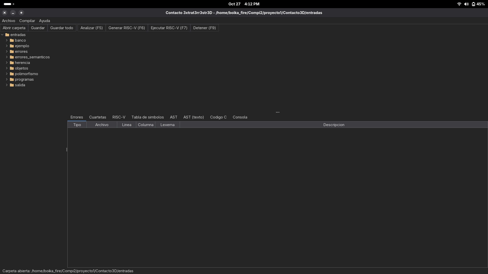
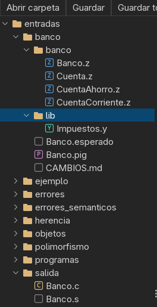
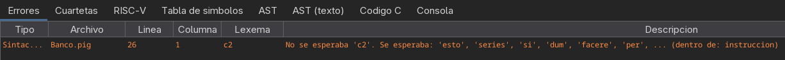
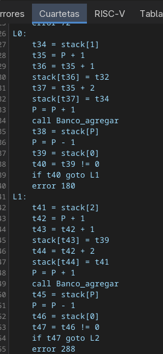
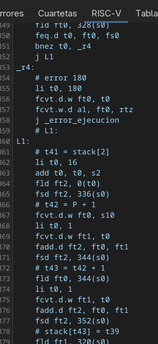
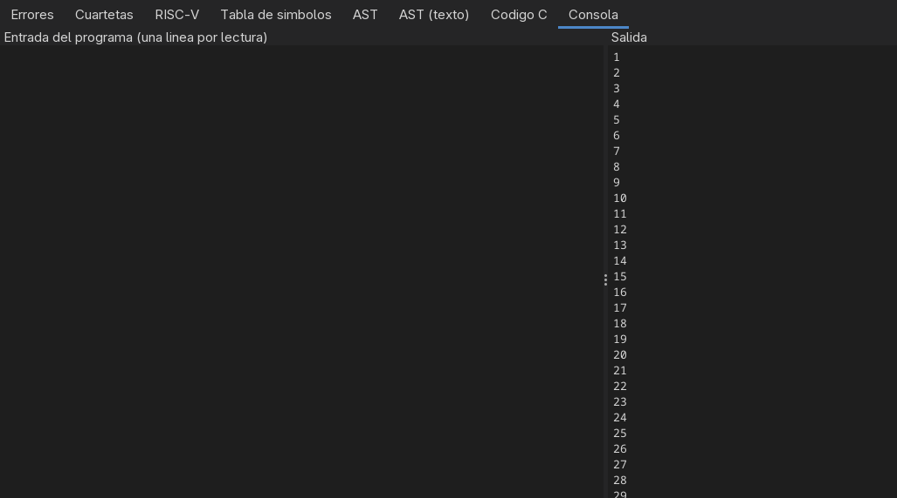

# Manual de usuario — Contacto 3xtrat3rr3str3D

Contacto 3xtrat3rr3str3D compila programas escritos en tres lenguajes: **Y?**, **Zetariano** y
**PigLatin**. Cada programa se convierte en código de tres direcciones (cuartetas) y de ahí en
**ensamblador RISC-V**, que la aplicación puede ejecutar con su propio simulador o que se puede
abrir en RARS. También se puede traducir a **C** y compilar con gcc.



---

## 1. Requisitos e instalación

- **Java 21** o superior.
- **Maven**, para construir el programa.
- **RARS 1.6** (opcional), para correr el `.s` generado fuera de la aplicación.
- **gcc** (opcional), para compilar el código C que se genera.

```bash
mvn clean package
java -jar target/contacto-3d-1.0.0.jar
```

Se puede pasar una carpeta para abrirla de entrada:
`java -jar target/contacto-3d-1.0.0.jar mi_proyecto/`. Sin argumentos se reabre la última
carpeta usada.

---

## 2. La ventana

| Zona | Para qué |
|---|---|
| Barra superior | Abrir carpeta, Guardar, Guardar todo, **Analizar (F5)**, **Generar RISC-V (F6)**, **Ejecutar RISC-V (F7)** y **Detener (F9)** |
| Izquierda: **árbol de trabajo** | Los archivos de la carpeta abierta |
| Centro: **editor** | Un archivo por pestaña, con números de línea y coloreado del lenguaje |
| Abajo: **resultados** | Las pestañas Errores, Cuartetas, RISC-V, Tabla de símbolos, Código C y Consola |
| Barra de estado | El resultado de la última acción |

**Íconos del árbol:**



| Ícono | Archivo |
|---|---|
| **Y** verde | Y? (`.y`): estructuras y funciones |
| **Z** azul | Zetariano (`.z`): una clase |
| **P** morado | PigLatin (`.pig`): el programa principal |
| **C** dorado | Código C generado (`.c`) |
| sin letra, gris | Cualquier otro archivo, por ejemplo el `.s` generado |

---

## 3. Trabajar con archivos y carpetas

| Acción | Cómo |
|---|---|
| Abrir un proyecto | **Archivo > Abrir carpeta** (`Ctrl+O`) |
| Abrir un archivo suelto | **Archivo > Abrir archivo** (`Ctrl+Shift+O`) |
| Abrir un archivo del árbol | Doble clic sobre él |
| Crear un archivo o una carpeta | Clic derecho en el árbol > **Nuevo archivo** / **Nueva carpeta** (o **Archivo > Nuevo archivo**, `Ctrl+N`). Se crea dentro de la carpeta seleccionada. El nombre debe llevar la extensión: `.y`, `.z` o `.pig` |
| Renombrar o eliminar | Clic derecho sobre el archivo o la carpeta. Eliminar una carpeta borra todo su contenido (pide confirmación) |
| Actualizar el árbol | Clic derecho > **Actualizar** (si se cambiaron archivos fuera del programa) |
| Guardar | `Ctrl+S` el archivo actual, `Ctrl+Shift+S` todos, **Guardar como...** con otro nombre |
| Cerrar una pestaña | La `x` de la pestaña, o `Ctrl+W`. Si tiene cambios, pregunta si guardarlos |
| Descargar el proyecto | **Archivo > Descargar proyecto (.zip)**: guarda la carpeta completa en un `.zip` |

Una pestaña con cambios sin guardar muestra un `*` antes del nombre. Antes de compilar se
guardan automáticamente todos los archivos abiertos.

---

## 4. Compilar y ejecutar

Se compila **el archivo de la pestaña activa**:

- un **`.pig`** es un programa completo: se compilan también los `.y` y `.z` que importa;
- un **`.y`** se analiza solo (útil para revisar una biblioteca);
- un **`.z`** se analiza junto con los demás `.z` de su carpeta, para que una clase pueda usar
  a las otras (por ejemplo, `Banco.z` usa `Cuenta`). Solo se muestran los errores del `.z` de la
  pestaña activa; los de las otras clases aparecen al analizar cada una.

**Menú Compilar**, en el orden de uso:

| Opción | Tecla | Qué hace |
|---|---|---|
| **Analizar** | `F5` | Valida el programa y llena las pestañas: errores, cuartetas, RISC-V, tabla de símbolos y C |
| **Ver cuartetas** | | Muestra la pestaña Cuartetas del último análisis |
| **Generar ensamblador RISC-V** | `F6` | Analiza y guarda el ensamblador en `salida/<programa>.s`, dentro de la carpeta del proyecto |
| **Ejecutar ensamblador RISC-V** | `F7` | Analiza, ensambla y ejecuta el `.s` en el simulador de la aplicación |
| **Detener ejecución** | `F9` | Detiene la ejecución RISC-V en curso |
| **Guardar ensamblador como...** | | Guarda el `.s` donde se elija |
| **Proyecto 1 >** | | El backend del Proyecto 1: ejecutar con el intérprete de cuartetas, generar el código C, compilarlo con gcc y ejecutarlo, y guardar el C |

### 4.1 Errores



La pestaña **Errores** lista cada error con estas columnas:

| Columna | Qué dice |
|---|---|
| Tipo | Léxico (rojo), sintáctico (naranja), semántico (amarillo) o de ejecución (morado) |
| Archivo, línea, columna | Dónde está el error; puede ser un archivo importado |
| Lexema | El texto que lo causó |
| Descripción | Qué está mal y qué se esperaba |

Los errores también se **subrayan en el editor**; al pasar el mouse sobre el subrayado aparece
la descripción. **Doble clic** en un error abre el archivo (aunque sea un import) y lleva a la
línea.

Si hay errores léxicos o sintácticos no se hace el análisis semántico, y si hay cualquier error
no se generan cuartetas, RISC-V ni C.

**Reglas que suelen dar error en Zetariano:**
- Un atributo o método **sin modificador es `private`**: solo se puede usar dentro de su
  propia clase. Para usarlo desde una subclase hay que declararlo `protected`, y para usarlo
  desde otra clase o desde el `.pig`, `public`.
- Un método que sobrescribe uno del padre **debe** llevar `@Override`. Un `@Override` que no
  sobrescribe nada también es error.
- `super(...)` solo puede ir como **primera** instrucción de un constructor.

### 4.2 Cuartetas y tabla de símbolos



**Cuartetas** muestra el código de tres direcciones:
- cada función empieza con `funcion nombre:`;
- los saltos usan etiquetas `L0`, `L1`…;
- los valores intermedios usan temporales `t0`, `t1`…;
- una llamada a un método sobrescrito aparece como `call_indirecto`: el método se elige en
  ejecución, según la clase real del objeto.

**Tabla de símbolos** lista cada variable, parámetro, función, estructura y clase, con su ámbito
y su lugar en memoria:
- `STACK`: relativo al marco de la función;
- `GLOBAL`: las variables de `VARIABILES>`;
- para campos y atributos, su desplazamiento dentro de la estructura u objeto. En una clase,
  los atributos empiezan en el desplazamiento 1, porque la celda 0 es de la vtable.

Se puede ordenar haciendo clic en una columna.

### 4.3 El ensamblador RISC-V



La pestaña **RISC-V** muestra el `.s` generado. Antes de cada grupo de instrucciones hay un
comentario con la cuarteta que traduce, así que se puede seguir cuarteta por cuarteta. Con
**Generar ensamblador RISC-V** (`F6`) queda guardado en `salida/<programa>.s`.

Para correrlo en **RARS**:
1. **File > Open** el `.s`.
2. **Run > Assemble** (`F3`).
3. **Run > Go** (`F5`).
4. Escribir en la consola de RARS lo que el programa pida leer.

La salida debe ser la misma que la de **Ejecutar ensamblador RISC-V** en la aplicación.

### 4.4 Ejecutar y la consola



La pestaña **Consola** tiene dos partes:
- **A la izquierda** se escribe, **antes de ejecutar**, lo que el programa va a leer: una línea
  por cada lectura (`<<`, `leer()`, `readln()`).
- **A la derecha** aparece lo que el programa imprime.

Al terminar, la barra de estado dice cuántas instrucciones RISC-V se ejecutaron.

**Detener (`F9`)** corta una ejecución que no termina, por ejemplo un ciclo infinito. El
simulador además se detiene solo después de 1 000 millones de instrucciones.

Los **errores de ejecución** detienen el programa y aparecen en la consola y en la pestaña
Errores (en morado), con archivo y línea:
- índice fuera de rango;
- usar un objeto `null` (`.atributo`, `.metodo()` o un índice);
- división entre cero.

> **Para ejecutar, la pestaña activa tiene que ser el `.pig`.** Solo un `.pig` tiene programa
> principal (`MAIOR>`); un `.y` o un `.z` solo define funciones, estructuras o clases, y al
> ejecutarlo la consola avisa que no hay nada que ejecutar. Si el programa tiene errores,
> tampoco se ejecuta: la consola lo dice y queda seleccionada la pestaña **Errores**.

### 4.5 Proyecto 1: intérprete y C

El submenú **Compilar > Proyecto 1** conserva el backend anterior:

| Opción | Qué hace |
|---|---|
| Ejecutar con el intérprete de cuartetas | Corre las cuartetas directamente, sin ensamblar |
| Generar código C | Guarda el programa en `salida/<programa>.c` y lo muestra en la pestaña Código C |
| Compilar con gcc y ejecutar | Compila el C con gcc y lo corre; se detiene si tarda más de 10 segundos |
| Guardar código C como... | Guarda el `.c` donde se elija |

Los tres caminos (intérprete, RISC-V y C) dan la misma salida para el mismo programa.

---

## 5. Los tres lenguajes en breve

### Y? (`.y`) — estructuras y funciones

La **indentación define los bloques** (un tab equivale a 4 espacios). No hay variables
globales.

```
%estructuras
estructura Punto:
    entero x
    entero y

%funciones
definir distancia({} Punto p) -> entero:
    retornar p.x * p.x + p.y * p.y

definir factorial(entero n) -> entero:
    si (n <= 1) entonces
        retornar 1
    retornar n * factorial(n - 1)
```

Tipos: `entero`, `flotante`, `cadena`, `caracter`, `bool` (`verdadero`/`falso`). Arreglos y
estructuras se pasan por referencia con `[] entero a` y `{} Punto p`.

### Zetariano (`.z`) — una clase por archivo

El archivo debe llamarse como la clase (`Animal.z` → `class Animal`).

```java
public class Animal {
    protected String nombre;

    public Animal() { nombre = "sin nombre"; }
    public Animal(String n) { nombre = n; }

    public String hablar() { return "..."; }
}
```

```java
public class Perro extends Animal {
    public Perro(String n) { super(n); }

    @Override
    public String hablar() { return nombre + " dice guau"; }
}
```

Tipos: `int`, `double`, `char`, `boolean`, `String`. Tiene `%`, el ternario `? :`,
`+= -= *=`, `null`, `new`, matrices (`new int[3][3]`) y sobrecarga de métodos y constructores.

**Herencia:**

| Palabra | Para qué |
|---|---|
| `extends` | La clase hereda los atributos y métodos del padre. Solo se hereda de una clase |
| `public` / `protected` / `private` | Quién puede usar el miembro: todos / la clase y sus subclases / solo la clase. **Sin modificador es `private`** |
| `@Override` | Obligatorio antes de un método que sobrescribe uno del padre |
| `super(args)` | Llama al constructor del padre; solo como primera instrucción de un constructor. Si no se escribe, se llama al constructor sin parámetros del padre |
| `super.metodo(args)` | Llama a la versión del padre de un método sobrescrito |

Una variable del tipo padre puede guardar un objeto de una subclase, y al llamar a un método
sobrescrito se ejecuta el de la clase real del objeto.

### PigLatin (`.pig`) — el programa principal

```
import carpeta.Animal.z
import carpeta.Perro.z
import carpeta.Funciones.y

VARIABILES>
esto nombre : textum;
esto a : novus Perro("Firulais") : Animal ;
esto nadie : null : Animal ;

MAIOR>
>> "Tu nombre:";
nombre <<
>> a.hablar() >> " - factorial(5) = " >> factorial(5);
si (nadie == null) {
    >> "nadie es null";
} finis;
FINIS;
```

Tipos: `numerus`, `decimalis`, `textum`, `littera`, `bool` (`verum`/`falsus`). `>>` imprime,
`<<` lee. Las estructuras vienen de los `.y` y se inicializan en orden:
`esto p : Punto {3, 4};`. Los imports se buscan junto al `.pig` o en sus subcarpetas, así que
no importa en qué carpeta estén.

**Declaración con tipo explícito:** `esto a : novus Perro("Firulais") : Animal ;` declara `a`
de tipo `Animal` y le guarda un `Perro`.

**`null`:** solo se puede asignar o comparar con objetos y arreglos, no con primitivos ni con
`textum`.

---

## 6. Uso desde consola

Sin abrir la ventana:

```bash
java -cp target/contacto-3d-1.0.0.jar com.usac.contacto3d.Compilador --riscv salida/programa.s programa.pig
```

| Opción | Muestra |
|---|---|
| (ninguna) | Solo los errores |
| `--tabla` | Tabla de símbolos con la memoria asignada |
| `--c3d` | Cuartetas |
| `--riscv RUTA` | Guarda el ensamblador RISC-V |
| `--simular` | Ejecuta el ensamblador en el simulador (lee la entrada estándar) |
| `--ejecutar` | Corre el programa con el intérprete de cuartetas (lee la entrada estándar) |
| `--c RUTA` | Guarda el programa en C |
| `--tokens`, `--arbol`, `--ast` | Tokens, árbol de ANTLR y árbol sintáctico abstracto |

---

## 7. Preguntas frecuentes

**"No se encontró el archivo importado".** El import se busca junto al `.pig`, junto a su
carpeta padre y en todas las subcarpetas de la carpeta del `.pig`. Revisá el nombre y la
extensión (`import carpeta.Archivo.z`).

**"La clase 'X' está en 'Y.z'".** En Zetariano el archivo debe llamarse exactamente como la
clase.

**"El atributo 'x' no tiene modificador, así que solo es accesible dentro de 'X'".** Sin
modificador es `private`. Declaralo `public` (o `protected` si solo lo usan las subclases).

**"El método 'm' sobrescribe uno de la clase 'X' y debe llevar @Override".** Agregá
`@Override` en la línea anterior al método.

**"La clase 'X' no tiene constructor sin parámetros".** El constructor de la subclase debe
empezar con `super(...)` y los argumentos de algún constructor del padre.

**"Indentación inconsistente" en Y?.** Las líneas de un mismo bloque deben tener la misma
sangría. Mezclar tabs y espacios suele causarlo: un tab cuenta como 4 espacios.

**El programa no termina.** Presioná **Detener** (`F9`). Si leía datos, revisá que la entrada
de la consola tenga una línea por cada lectura.

**"Compilar con gcc y ejecutar" dice que no encuentra gcc.** Instalalo (`sudo dnf install gcc`
o `sudo apt install gcc`) o usá **Ejecutar ensamblador RISC-V** (`F7`), que no lo necesita.
